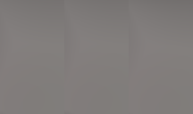
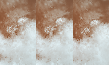
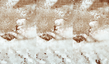
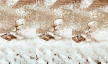
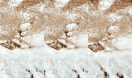
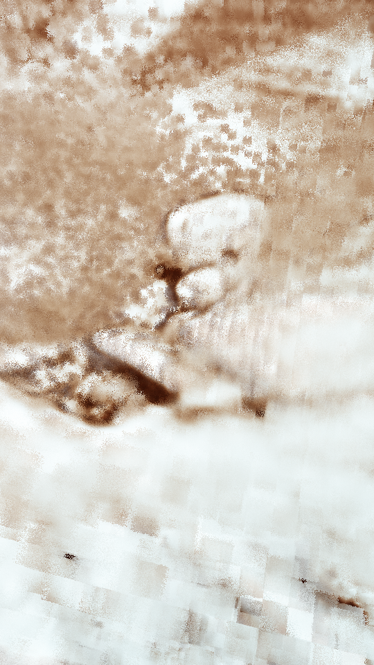

# ffnerf — experimental fully fused NeRF in PyOpenCL

Train a neural radiance field from photographs and camera poses produced by the
companion [custom SfM project](https://github.com/MolSzabi/sfm_BA_numpy_opencl).
The OpenCL implementation combines a multiresolution hash encoding, density/color
networks, ray marching, and occupancy sampling. This is an experimental research
release: pose quality, scene bounds, training settings, and GPU drivers matter.

The supported workflow is **inspect → train → review**, using one JSON scene
config. No COLMAP or `transforms.json` conversion is needed for custom SfM output.

This project builds on the neural radiance field and volume-rendering ideas in
[NeRF: Representing Scenes as Neural Radiance Fields for View Synthesis](https://www.matthewtancik.com/nerf/)
(Mildenhall et al., 2020), and the multiresolution hash encoding and efficient GPU
implementation ideas in NVIDIA's
[Instant Neural Graphics Primitives with a Multiresolution Hash Encoding](https://nvlabs.github.io/instant-ngp/)
(Müller et al., 2022). It implements these ideas experimentally in PyOpenCL,
with custom sampling, optimization, and SfM integration, rather than attempting
to faithfully reproduce either paper or its reference implementation.

### Example reconstruction

The maintainer's low-quality test dataset produces the following progression
using the companion SfM pipeline and this training workflow. These are example
results, not a benchmark or a guarantee for other scenes; input images and model
checkpoints are not included in this repository.

| Step 456 | Step 4,039 | Step 8,697 | Step 14,924 | Step 19,517 |
|:---:|:---:|:---:|:---:|:---:|
|  |  |  |  |  |

**Example training configuration:** 512 rays/batch × 64 samples/ray, 56 input
images at 450×800 resolution. Training to approximately 20k steps took about
20 minutes on an AMD RX 580 2048SP. Current starting settings are in
[configs/example.json](configs/example.json); learning-rate settings were adjusted
between runs, so this is not an exact reproduction recipe for every image above.

After continued training to 40,000 steps:



## Setup

The local verification environment is Windows, Python **3.10.4**, with an AMD
Ellesmere OpenCL GPU. Other devices and systems are unverified. Install a working
OpenCL driver/runtime for your GPU; PyOpenCL alone does not provide one.

From the ffnerf repository root, in PowerShell:

```powershell
py -3.10 -m venv .venv
.\.venv\Scripts\Activate.ps1
python -m pip install -r requirements.txt
python -c "import pyopencl as cl; print([(p.name, [d.name for d in p.get_devices()]) for p in cl.get_platforms()])"
```

Use `.\.venv\Scripts\python.exe` instead of `python` if activation is unavailable.
The requirements record the directly used versions in the verification environment.
The current device selector prefers AMD platforms, then Intel, and selects the
first available device on that platform. Training needs GPU memory for model,
optimizer, sampling maps, and batch buffers; reduce `batch_rays` if allocation fails.
All training images are held in host memory; reduce `data.max_side` to lower RAM use.

OpenCL compilation caching is enabled by default. The first build for a source,
device/driver, and set of build options may take a while; subsequent runs can
reuse compiled binaries in `training.directory/_pyopencl_cache/`. The pinned
PyOpenCL 2026.1.2 fixes a cache error in 2026.1.1, so update an existing environment
with `python -m pip install -r requirements.txt`. For compiler debugging, set
`$env:PYOPENCL_NO_CACHE = "1"` before launching Python; set it to `"0"` to enable
caching again. The scripts respect your setting.

## Start with custom SfM

Keep the repositories side by side (`SfM/` and `ffnerf/`). In **SfM**, using
**SfMenv**, prepare and inspect the scene:

```powershell
python stage1_features_pairs.py datasets/test_dataset/images --out datasets/test_dataset/data/matches.npz --tmp-dir datasets/test_dataset/data/debug --max-side 1600
python stage2_solver.py --matches datasets/test_dataset/data/matches.npz --out-dir datasets/test_dataset/data/solve --use-lcc
python step3_bundle_adjust_v2cl.py --recon datasets/test_dataset/data/solve/reconstruction.npz --matches datasets/test_dataset/data/matches.npz --tracks datasets/test_dataset/data/solve/tracks.npz --out datasets/test_dataset/data/solve/reconstructionBAcl.npz --kernels kernels_bundle_adjust_v2-mobile.cl --iters 12 --verbose
python see_reconstructed_dat_o3d.py datasets/test_dataset/data/solve/reconstructionBAcl.npz
```

Check that sparse geometry and camera placements are plausible before training.
SfM provides its own viewer dependencies and scene adjustment tools; see its README.
Optional alignment with `adjust_scene.py` should use the BA archive. If you align
the scene, point the ffnerf config at the adjusted output and inspect it again.
The free camera uses world +Z as up, so alignment can make navigation easier.

After those commands, switch back to **ffnerf** and its **.venv**. ffnerf reads the
BA archive directly; matches and tracks are not required for training.

## Configure and inspect

```powershell
Copy-Item configs/example.json configs/test_dataset.local.json
python ffnerf_cli.py inspect --config configs/test_dataset.local.json
```

Edit `configs/test_dataset.local.json`. Personal `*.local.json` configs are ignored.
**Paths inside the config are relative to that config file**, not the working
directory. Absolute paths also work. The example points at the sibling SfM
`test_dataset` from the commands above; a clone does not include datasets.

| Setting | Meaning |
| --- | --- |
| `data.reconstruction` | BA or Stage 2 NPZ archive. |
| `data.images_dir` | Relocate archived image paths by filename; use `""` to use stored paths. Filenames must be unique. |
| `data.sfm_max_side` | Stage 1 resize limit, **1600** for the commands above. |
| `data.max_side` | Training image limit; default 800, or 0 for original resolution. |
| `scene.box_min`, `scene.box_max` | World-space xyz bounds of the modeled region. With both null, ffnerf forms the 1st–99th percentile sparse-point AABB, takes its circumscribing sphere, enlarges that radius by 1.5×, and uses the corresponding cubic AABB. |
| `scene.near` | Near ray clip in SfM world units; scale is arbitrary. |
| `training.directory`, `model_id` | Output directory and checkpoint family. Use a new ID for a new experiment. |
| `training.steps` | Number of **additional** optimization steps, including on resume. |
| `training.period` | Loss reporting interval in optimization steps. |
| `training.batch_rays`, `samples_per_ray` | Batch size and samples per ray; supplied kernels support at most 64 samples. |
| `training.lr`, `lmd`, `seed` | Base learning rate, learning-rate decay coefficient, and random seed. The existing schedule scales with batch size and has a floor. |
| `preview.enabled`, `host`, `port` | Training browser preview; default `http://127.0.0.1:8080/`. |
| `preview.width`, `height`, `downscale` | Preview camera resolution and downsampling factor. |
| `preview.views` | Registered-camera list indices for saved multiview previews; `[]` disables these images. |
| `preview.save_seconds`, `image_seconds` | Checkpoint and multiview-image intervals. |
| `viewer.width`, `height`, `block_size` | Review resolution and progressive block size; both dimensions must be divisible by the block size. |
| `viewer.camera`, `move_speed` | Initial camera index in the registered list and navigation speed. |

Use the source-image aspect ratio for preview and viewer dimensions. Intrinsics
are scaled for every image resolution. Camera indices in `preview.views` and
`viewer.camera` are zero-based indices into the **filtered registered list**, not
SfM global IDs. `inspect` prints those IDs, validates image decoding and consistent
sizes, reports memory use, and prints the resolved box. Automatic bounds are a
deliberately generous starting point around the sparse reconstruction. Copy them
into the config if you want fixed/manual bounds, and adjust them if the modeled
subject is clipped or the box contains too much unrelated space. Cameras may be
outside the scene box.

The loader reads BA `RT`/`rt_dir` (c2w or w2c) and Stage 2 `c2w`, filtering
`posed & keep_mask` before loading images. It preserves OpenCV camera axes:
x right, y down, z forward. Only load trusted NPZ archives; SfM path metadata uses
NumPy object arrays. Images must have consistent dimensions and camera intrinsics.

## Train and continue

First verify a short run under a separate model ID:

```powershell
python ffnerf_cli.py train --config configs/test_dataset.local.json --model-id test_dataset_smoke --steps 20
python ffnerf_cli.py snapshot --config configs/test_dataset.local.json --model-id test_dataset_smoke
```

Then start the configured run:

```powershell
python ffnerf_cli.py train --config configs/test_dataset.local.json
```

Open `http://127.0.0.1:8080/` during training. Drag to look, use WASDQE or the
on-screen buttons to move, **Save frame** to write a PNG, and **Stop training** to
stop and save. The page shows the training step and preview frames. Loss is printed
in the terminal and written to CSV. To use a phone on your LAN, set `preview.host`
to `0.0.0.0` and open the PC's LAN address. This control server has no authentication;
keep it on a trusted network. `--no-web` disables it for a run.

Press **Ctrl+C once** for a graceful stop and final checkpoint. A second press
within two seconds forces exit and can skip saving. Do not close the process
while it is writing a checkpoint.

Continue weights, optimizer state, occupancy, and the step-based schedule:

```powershell
python ffnerf_cli.py train --config configs/test_dataset.local.json --resume test_dataset --steps 10000
```

For a branch of an existing experiment, add `--model-id test_dataset_variant`.
The loader selects the most recently modified checkpoint of the resume ID. Keep
scene, camera ordering, image preparation, and network architecture consistent
when resuming. Checkpoint bounds take precedence on load. RNG/sampling queues are
reinitialized, so continuation is not bit-for-bit deterministic. Starting fresh
with an existing output ID is refused to protect earlier progress.

Output files in `training.directory`:

- `<id>_weights_<timestamp>.npz` and `<id>_weights_latest.npz`: model/optimizer state.
- `<id>_config_<timestamp>.json`: resolved paths and bounds for that invocation;
  use this with `--config` to reproduce the review settings.
- `<id>_loss_<timestamp>.csv`: sampled training loss (not a held-out quality score).
- `<id>_preview_*_multiview.png`: fixed dataset views, first saved near the start.
- `<id>_preview_*_live.png`: browser Save frame output.

Checkpoints are written periodically and on graceful completion. The first save
and final save write timestamped copies. Regular interval saves refresh `latest`;
another timestamped copy is made only if `latest` is at least five minutes old.
With the default two-minute save interval, do not expect timestamped copies every
five minutes. Generated training outputs are ignored by Git; selected example
images under `examples/` are intentionally included.

## Review a trained model

```powershell
python ffnerf_cli.py review --config configs/test_dataset.local.json
python ffnerf_cli.py snapshot --config configs/test_dataset.local.json --output training/test_dataset/review.png
```

`review` opens the Pygame viewer and loads the newest checkpoint for the configured
model ID. WASD moves, Q/E moves vertically relative to the camera, arrows turn,
and Esc exits. The image refines progressively while stationary. It initially
renders the exact configured dataset camera; navigation then uses +Z-up yaw/pitch.
`snapshot` renders that exact camera, including roll, to a PNG without opening a
window. Its default filename is timestamped; an existing `--output` is refused.
Change `viewer.camera` to compare other input viewpoints, and inspect novel views
for pose errors, floaters, or missing geometry. A short successful run establishes
that the pipeline executes, not that the model has converged.

## Repository and experimental scope

The active implementation remains `run_ffnerf_OG.py`, `ffnerf_tools.py`,
`render_nerf.py`, `nerf_web_remote.py`, and the three active `.cl` files. Start with
`ffnerf_cli.py`; the old trainer's `--mode render` path is unavailable. Network and
kernel architecture constants remain in code and must agree when modified.

Old kernels, synthetic-data helpers, debugging notes, and the unfinished package
refactor were moved to ignored `local/archive/experiments/`. Originals of root
files before cleanup are in `local/archive/pre-release-20260928/`, including the
pre-existing working-tree diff. Existing datasets and training checkpoints stay
at their original paths and are ignored. These local archives are deliberately
not included in a public clone; see [cleanup notes](docs/cleanup.md).

CPU contract checks:

```powershell
python -m unittest discover -s tests -v
```

The maintainer has run the custom SfM pipeline, training, resume, smoke tests,
and the preview/review workflow on the test scene shown above. Output quality
and performance across devices remain experimental; there is no automated
convergence or visual-quality gate. See [verification notes](docs/validation.md).

## License

MIT, copyright 2026 Szabolcs Molnar. See [LICENSE](LICENSE).
